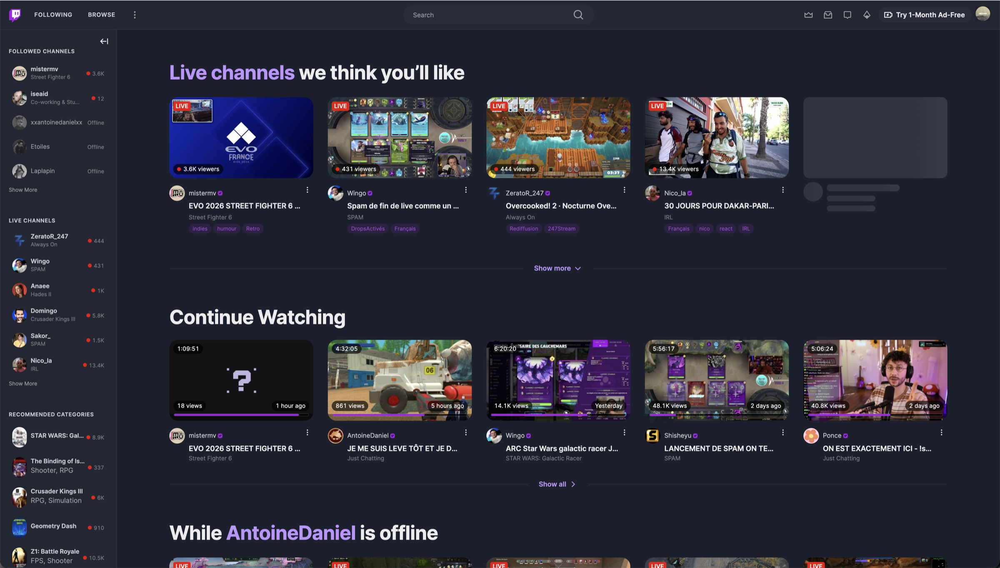
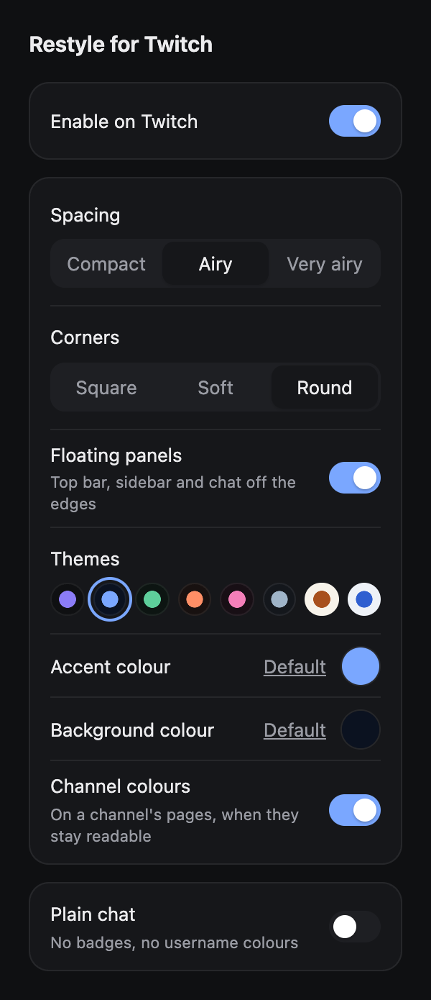

<p align="center">
  
</p>

<h1 align="center">Restyle for Twitch</h1>

<p align="center">A calmer, more coherent interface for twitch.tv, as a Chrome and Firefox extension.</p>



Restyle for Twitch is a stylesheet layered over twitch.tv. It does not add
features or change how Twitch works: it quiets the noisy parts, gives the
content more room, and makes the pages look like they belong to the same site.

It is an unofficial project, not affiliated with or endorsed by Twitch.

## What it changes

- **Sidebar**: smaller, quieter rows, small-caps section headers, viewer counts
  aligned to the right. Hover cards and the "For You" header are gone, and
  stories are hidden unless you turn them back on.
- **Top bar**: more breathing room, a pill-shaped search field, dimmed icons.
- **Home, Following and Browse**: no autoplaying carousel unless you ask for
  it (it is then restyled like the cards under it), large shelf titles,
  rounded thumbnails, and cards that put the streamer's name first. Tags become
  small accent-coloured chips. Hovering a card dims the ones around it, and
  video cards no longer play an animated preview.
- **Channel page**: a rounded, inset player and a centred column for the stream
  information and panels.
- **Team page**: the full-page photo and the white sheet are gone. A header
  panel with the team's logo, name and banner, the player with the stream's
  information under it, and the members in a panel on the right.
- **Chat**: muted messages that return to full contrast on hover, a fade at the
  top, and no leaderboard above it. Its popups (emotes, cheers, rewards, drops,
  chat identity) share one framed style.
- **Themes**: eight ready-made colour pairs, or the colours of the channel you
  are watching.
- **Menus and dialogs**: flat surfaces with a border instead of shadows, and a
  dimmed backdrop behind dialogs.

Creator Dashboard (`dashboard.twitch.tv`) is left untouched.

## Settings

Click the extension's icon to open its settings. Changes apply immediately,
without reloading the page.

| Setting | What it does |
| --- | --- |
| Enable on Twitch | Turns the whole restyle on or off. |
| Spacing | Three densities: compact, airy, very airy. |
| Corners | How rounded cards, panels, fields and buttons are: square, soft or round. |
| Floating panels | Takes the top bar, the sidebar and the chat off the window's edges, as rounded panels. |
| Themes | Eight ready-made pairs of background and accent colours, dark and light. |
| Accent colour | The colour of links, tags and highlights. |
| Plain chat | Hides chat badges and shows every username in the text colour. |
| Background colour | The page colour. Sidebars, chat, menus and text colours are derived from it. Reset to follow Twitch's own light or dark theme. |
| Channel colours | On a channel's pages, takes the accent and a tinted background from the channel's own colour, adjusted until text stays readable. Channels without a colour, or with a grey one, keep your settings. |
| Home carousel | Shows the featured streams at the top of the home page. Off by default: the carousel is hidden and its video paused. |
| Stories | Shows stories in the sidebar and on Following. Off by default. |



The settings popup follows the browser's language: English, French, Spanish,
Portuguese, German, Italian, Dutch, Polish, Turkish, Russian, Japanese, Korean
and Chinese (simplified and traditional). Other languages get English.

## Install

### Chrome

Install it from the [Chrome Web Store](https://chromewebstore.google.com/detail/restyle-for-twitch/hecbaaniegkffdanpfelapppfnjlbfbl).
It needs Chrome 120 or later, and should work in other Chromium browsers of
the same generation. Chrome keeps it up to date.

To install it by hand instead:

1. Download [restyle-for-twitch.zip](https://github.com/corentin-gautier/restyle-for-twitch/releases/latest/download/restyle-for-twitch.zip)
   from the [latest release](https://github.com/corentin-gautier/restyle-for-twitch/releases/latest)
   and unzip it.
2. Open `chrome://extensions` and turn on **Developer mode**.
3. Click **Load unpacked** and select the unzipped folder.

Keep that folder: Chrome loads the extension from it. To update, replace its
contents with a newer release and click the reload button on the extension's
card.

### Firefox

The extension has been submitted to Firefox Add-ons and is waiting for
review. Firefox only installs signed add-ons for good, so until it is listed
there it can only be loaded for the current session:

1. Download [restyle-for-twitch-firefox.zip](https://github.com/corentin-gautier/restyle-for-twitch/releases/latest/download/restyle-for-twitch-firefox.zip)
   from the [latest release](https://github.com/corentin-gautier/restyle-for-twitch/releases/latest).
2. Open `about:debugging#/runtime/this-firefox`.
3. Click **Load Temporary Add-on** and select the zip.

Firefox removes it when it closes. It needs Firefox 140 or later.

## Privacy

The extension only runs on `twitch.tv`. It collects nothing and sends nothing
anywhere. Its one permission, `storage`, is used to remember your settings.

## Development

The stylesheet is written in Sass and compiled to one file, `src/restyle.css`,
which is not in the repository. To work on it, clone the repository, then:

```sh
npm install
npm run build    # once, or
npm run watch    # rebuilds on every save
```

and load the folder with **Load unpacked**. The extension is made of:

| Path | Role |
| --- | --- |
| `src/scss/` | The stylesheet's source. `restyle.scss` lists every file in cascade order. `base/` holds the design tokens (spacing, radii, type scale, palette) and the theme; `layout/` the top bar, the sidebar and the page column; `components/` what the whole site shares (cards, tabs, menus, player popups); `pages/` one file per page or per tab of a page, each page's folder holding the components only it uses (the chat under `pages/channel/components/`); `tools/` the shared mixins and the one that writes the selectors' performance guards. |
| `src/restyle.css` | The compiled stylesheet, the only one the extension loads. Never edited by hand. |
| `src/content.js` | Applies the settings, marks what the stylesheet needs to know about the page, pauses the home carousel's video while it is hidden and stops the video cards' animated previews. |
| `popup/` | The settings popup. |
| `src/dev-reload.js` | Live reload, for unpacked installs only. |

When loaded unpacked, the extension reloads itself and any open Twitch tab
whenever the compiled stylesheet or a JavaScript file changes: with
`npm run watch` running, saving a Sass file is enough.

To build the store packages, which leave the live reload out:

```sh
./scripts/package.sh            # Chrome Web Store
./scripts/package.sh firefox    # Firefox Add-ons
npm run package                 # both
```

The zips are written to `dist/`. The script needs Node.js and the
dependencies (`npm install`): it compiles the stylesheet, minified, before
zipping. The Firefox manifest is derived from `manifest.json`: it gains the
add-on id and the data collection statement Firefox asks for.

### Releasing

Releases are cut with `npm run release` (version bump, changelog, tag).
Pushing the tag publishes a GitHub release with both zips attached, then
submits each package to its store, where it waits for review as usual.

A store is skipped until its repository secrets are set (**Settings >
Secrets and variables > Actions**):

| Secret | Where it comes from |
| --- | --- |
| `CWS_PUBLISHER_ID` | The publisher ID shown in the Chrome Web Store developer dashboard, under **Publisher > Settings**. |
| `CWS_CLIENT_ID`, `CWS_CLIENT_SECRET` | An OAuth client of a Google Cloud project with the Chrome Web Store API enabled. Set the consent screen to "In production": a refresh token issued in "Testing" expires after a week. |
| `CWS_REFRESH_TOKEN` | A refresh token for that client with the scope `https://www.googleapis.com/auth/chromewebstore`, obtained once with the account that owns the extension (see [Use the Chrome Web Store API](https://developer.chrome.com/docs/webstore/using-api)). |
| `AMO_JWT_ISSUER`, `AMO_JWT_SECRET` | The API credentials generated on [addons.mozilla.org](https://addons.mozilla.org/developers/addon/api/key/). |

Each store has its own job in the workflow. To submit the current version to
a store again without a new tag (after fixing a secret, say), run the
"Release" workflow by hand from the Actions tab and pick the store.

## Known limits

Twitch's markup has few stable hooks and changes without notice, so a Twitch
update can break part of the restyle. If something looks wrong, please open an
issue with a screenshot and the page's address.

Some rules match English labels, so a few details may be missing when Twitch is
displayed in another language.

## Support

If Restyle for Twitch is useful to you, you can support my work with a small donation on [Ko-fi](https://ko-fi.com/corentingautier). Thank you!

## License

Copyright © 2026 Corentin Gautier.

Restyle for Twitch is free software, released under the
[GNU Affero General Public License, version 3](LICENSE). You may use, modify
and share it, provided that copies and modified versions keep the copyright
notices, stay under the same license, and come with their source code. It is
provided without any warranty.
